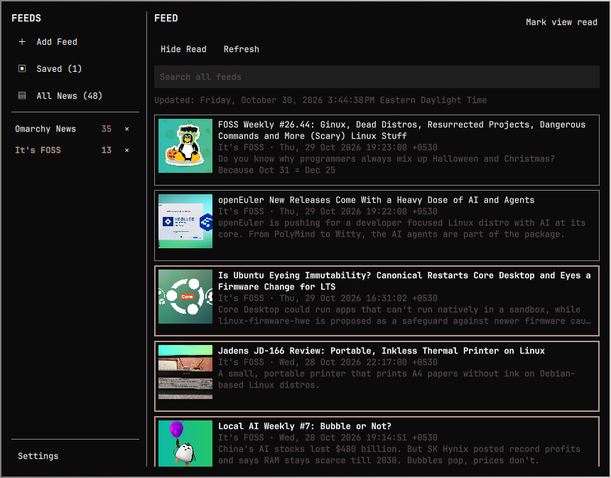

# MyRSS

**Your feeds, your reading space.**

An Omarchy shell RSS/Atom reader with folders, saved articles, search, OPML
import/export, and a slide-out reading view.



## Installation

```sh
omarchy plugin add https://github.com/kelmankenberg/MyRSS.git --enable
```

The plugin ID is `kel.news-reader`. Python 3 is required; install Zenity if it
isn't already available to use the OPML file pickers:

```sh
omarchy pkg add zenity
```

## Removal

```sh
omarchy plugin remove kel.news-reader
```

Subscriptions, saved articles, and reading history remain in
`$XDG_STATE_HOME/omarchy/news-reader` (`~/.local/state/omarchy/news-reader` by
default), so reinstalling can restore them. Removal does not uninstall Python
or Zenity.

## Features

- **Omarchy News** (`https://omarchy.org/news/rss.xml`) is included and fetched
  the first time the reader opens. Add other HTTPS RSS or Atom URLs as needed;
  feeds refresh when added or when you press **Refresh**.
  Pasted HTTP feed addresses are upgraded to HTTPS; insecure downloads are
  not supported.
- **Saved** archives bookmarked stories independently of feed caches, including
  their readable text once fetched. Refreshing or deleting a feed does not
  delete saved stories. Saved stories can be read offline; uncached images
  still require a network connection. Unsave a story to remove its archive.
- **All News** combines every feed. Its counter and each feed's counter show
  unread stories; Saved shows the total number of archived stories.
- The bar icon highlights only for new unread articles received while MyRSS
  is closed. Opening the reader clears the highlight without marking articles
  read; it returns when more new articles arrive. This survives shell restarts.
- Search looks through all feeds; unread stories are bold and marked with an
  accent border. Search also finds archived stories from removed feeds.
- **Mark view read/unread** applies to the selected feed, folder, Saved list,
  or global search results, including stories hidden by the read filter.
  Settings has a separate **Mark ALL feeds read/unread** action.
- Settings provides optional 15/30/60-minute automatic refresh, per-feed
  update/error status and Retry, and optional new-unread-article notifications
  for scheduled refreshes. Both automatic refresh and notifications default
  to **Off**. Enabled refresh runs even with the reader panel closed, while
  the Omarchy shell is running.
- Reading uses the system font and live theme colors. Adjust article size
  with **A− / A+**, toggle images, and choose automatic read marking after
  2/5/10 seconds or turn it off. Defaults are 100%, images on, and five seconds.
  Article extraction prefers semantic article/main content and omits common
  page chrome; unusual or JavaScript-only pages may need **Open original**.
- Manage feeds in Settings: rename, assign a folder (empty means ungrouped),
  and reorder with the arrows within each folder. Click a folder name to read
  it; use its **+ / −** control to expand or collapse its subscriptions.
  Settings also creates and deletes folders, including empty ones. Deletion
  asks for confirmation and moves subscriptions to the main list without
  deleting them. Folder expansion states are remembered.
  Right-click anywhere in the Feed panel and choose **Create folder** to add
  one directly without opening Settings.
- Right-click a feed or folder for rename, refresh, read/unread, and delete
  actions. Feed **Move to folder** opens an editor with existing-folder choices
  and **No folder**; Apply saves the move. Folder renames preserve subscriptions,
  unread counts, and expansion state.
- Right-click a story or the article panel to open it in a browser, copy its
  link, save/unsave, or mark it read/unread.
- The selected feed, search, article, and reading scroll positions are restored
  when reopening or restarting the shell. Unsaved article text may need to be
  fetched again after a restart.
- Drag the reader's left edge to resize it, or use **Narrower / Wider / Reset
  width** in Settings. Preferred width is remembered and constrained to fit
  the screen.
- Import/export OPML using file pickers in Settings (provided by Zenity).
  Import lets you choose a file; Export lets you choose its folder and filename.
  Canceling either picker leaves subscriptions unchanged. Import preserves
  subscriptions and folders without removing existing feeds or fetching
  stories automatically. Press Refresh afterward. HTTP URLs are upgraded to
  HTTPS; an invalid/private URL rejects the import without partial changes.
  Export creates a new file and refuses to overwrite an existing one.
- Press **Escape** to close the article or Settings, then close the reader.
- Move the widget with `omarchy bar move kel.news-reader --section left`,
  `--section center`, or `--section right`.

## Keyboard

Outside text fields: **j/k** or **Down/Up** select stories, **Enter/Right**
opens one, **Left/Escape** closes it, **s** saves/unsaves, **m** toggles read,
**o** opens the original, **r** refreshes the current view, **/** focuses
search, and **?** opens Settings/help. **Tab/Shift+Tab** navigate controls;
**Enter/Space** activate a focused action. Escape in search clears the query,
then leaves the editor.

## Storage and limits

Feed and read state is kept in `$XDG_STATE_HOME/omarchy/news-reader/state.json`
(`~/.local/state/omarchy/news-reader/state.json` by default), outside the
plugin directory so saving data does not reload the widget. Network content is
displayed as plain text; feed downloads are capped at 2 MiB and thumbnails at
512 KiB. At most 100 subscriptions, 100 cached stories per feed, and 10,000 saved
stories are supported. Existing saved IDs are migrated to article snapshots
on first load; stories that had already vanished from the old cache cannot
be reconstructed. A dedicated Python helper creates the state directory with
owner-only permissions (`0700`) and state and temporary files with `0600`
before writing any content, independently of the shell's umask. Writes are
atomic and fsynced. Existing state permissions are repaired on load without
changing its data. Symlinked directories/files, hard-linked files, and files
not owned by the current user are rejected. Permission, read, and write failures
are shown in the reader and disable further persistence; invalid state is never
overwritten. Shared parent directories are not chmodded.

Feed, article, and thumbnail request URLs are sent to Python through stdin
pipes, never command-line arguments or environment variables. This keeps private
path/query access tokens out of process listings. Network failures use a fixed
error message rather than echoing server/library exceptions; thumbnail diagnostics
do not log request URLs. URLs still exist in the private state and process memory,
and are sent to the requested HTTPS server. Opening an article in an external
browser hands its URL to that browser.

Article extraction enforces parser-time limits: nesting depth 128, 50,000
elements, 256 content candidates, 16,384 retained fragments, and 1 MiB of
retained text counted across all candidate/fallback lists. These budgets bound
memory before final text truncation, including duplicated nested-article
fragments. Over-complex HTML is rejected with an explicit message directing
the reader to open the original in a browser.

## Requirements and distribution

Requires Omarchy's Quickshell/Qt 6 shell, Python 3, and Zenity for native OPML
file pickers. There are no Python package dependencies. A missing or failed
picker is reported in the reader instead of silently ignoring the action.

Distribute the plugin source and `LICENSE`, never live `state.json`, downloaded
content, or cache files. The legacy `state.json` in an existing installation is
private user data, not a plugin asset; current state lives outside this folder.

## Checks

```sh
PYTHONDONTWRITEBYTECODE=1 python3 -m unittest discover -s tests -v
node tests/test_reader.js
/usr/lib/qt6/bin/qmltestrunner -platform offscreen -input tests/tst_reader.qml
qmllint -I /usr/share/omarchy/shell BarWidget.qml Thumbnail.qml
```
